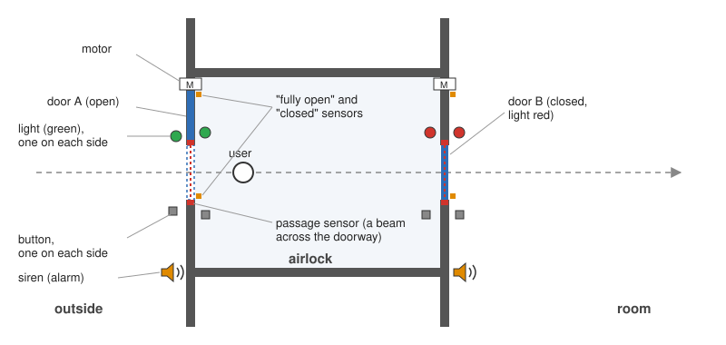
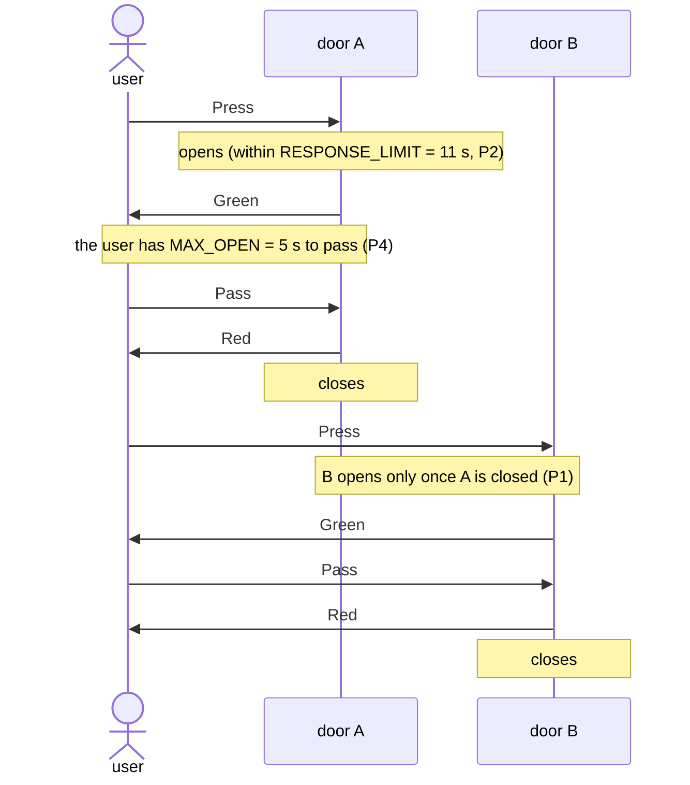
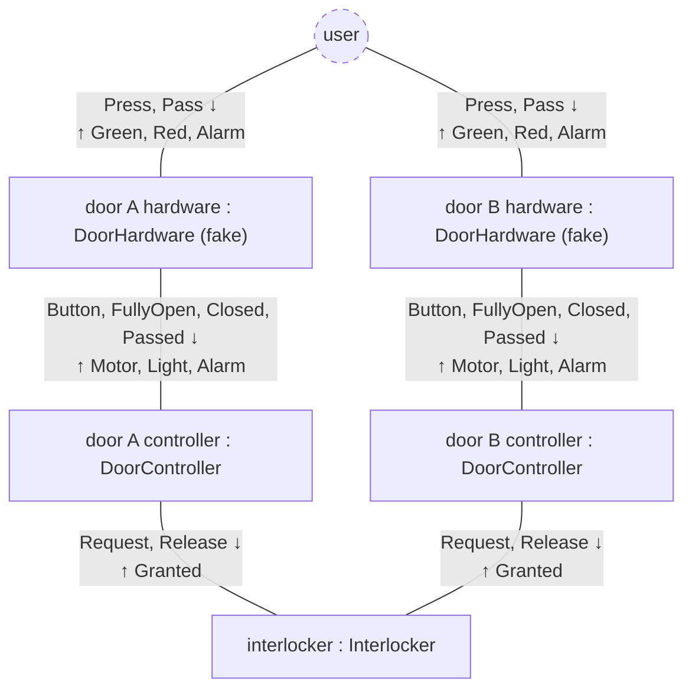
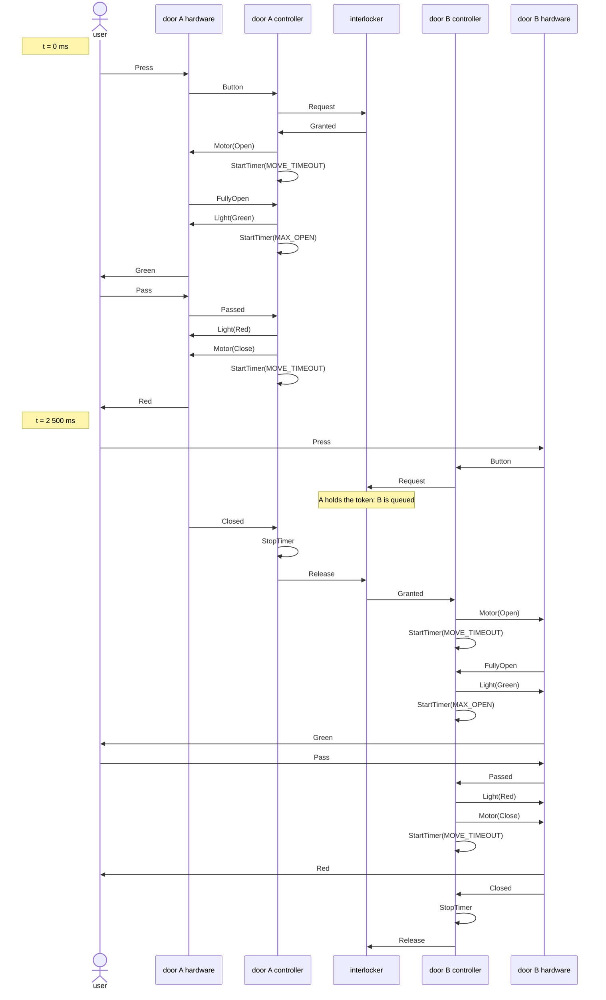
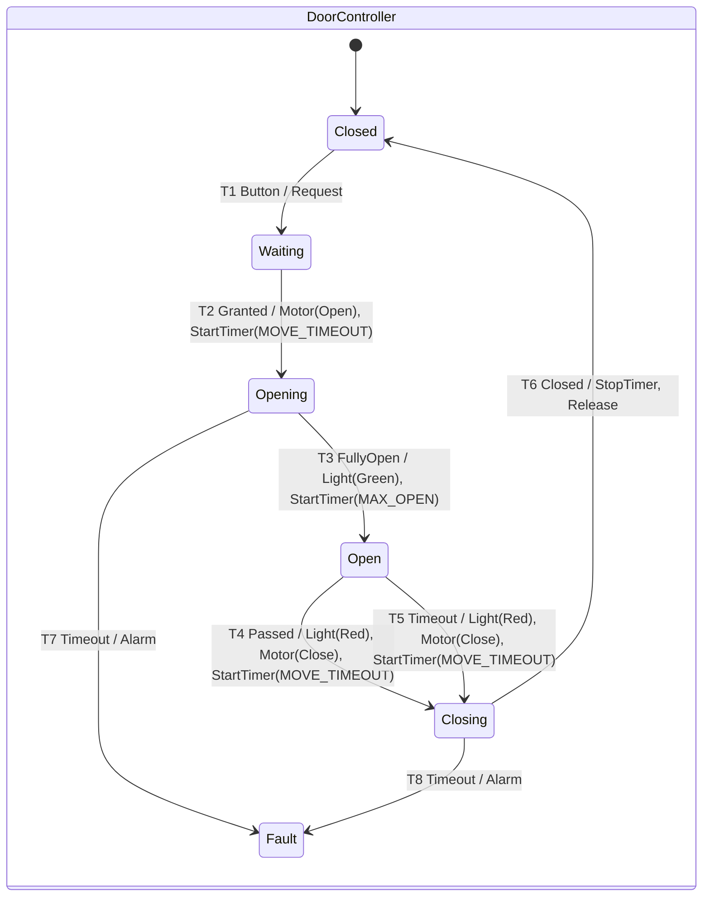
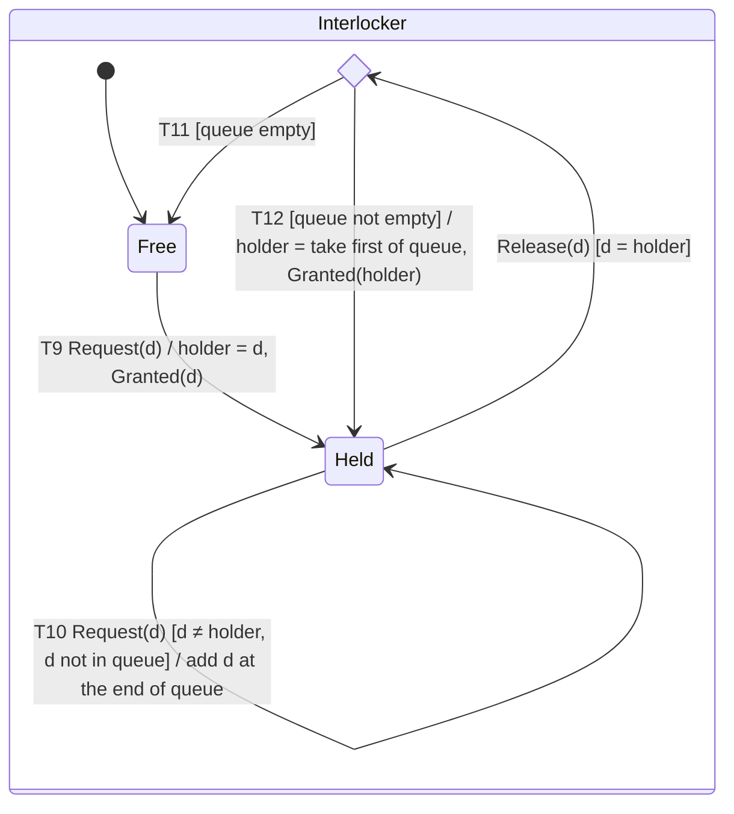
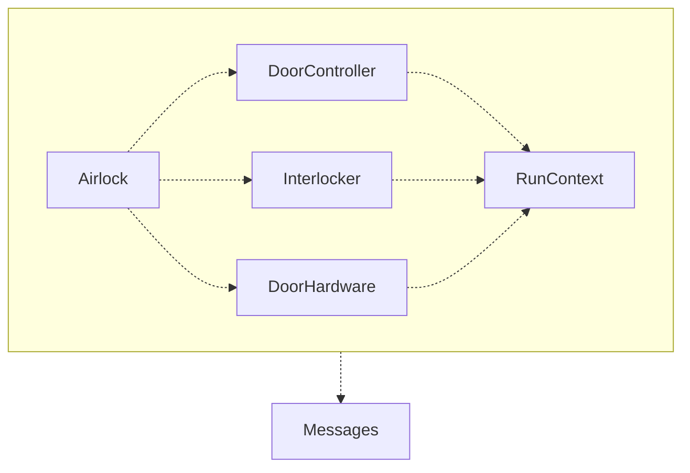

# Two-door airlock controller: specification

This document specifies the context, requirements and design of a two-door airlock controller, independently of the programming language. A test plan is provided in [TEST.md](TEST.md). Two implementations are provided in Java and Rust for the same specifications.
To facilitate cross reference and traceability (including from code), every item has an id.

## 1. Context

A room is entered through an airlock with two motorised doors, A and B (Figure 1).

**Figure 1.** *The airlock seen from above. Door A is open and its light is green; door B is closed and its light is red. Each door slides into the wall, driven by a motor (M).*

Each door has:
- a motor, and "fully open" and "closed" sensors;
- a "passed" sensor: a light beam across the doorway, which reports that someone went through, in either direction, once the beam has been broken and then stayed clear for a short while, so that people walking through together count as one passage;
- a button and a light on each side, the two buttons wired together and the two lights showing the same colour; the light tells the users when to go through: green while the door is fully open, red otherwise;
- a siren, for the alarm, activated in case a door gets stuck.

## 2. Requirements

### 2.1 Functional requirements

This section describes what the airlock does for its users: the journeys they make (user stories), and the alternative and exception flows that can happen in any of them. They say
what happens; section 2.2 says within what limits.

#### Table 1. Users' journeys

| # | Journey |
|---|---|
| J1 | A user goes in: presses door A's button, goes through when its light is green, then presses door B's button and goes through B when its light is green (Figure 2, section 2.3). |
| J2 | A user goes out: the same, through B and then A. |
| J3 | A user changes their mind and comes back out through the door they came in by. |
| J4 | Several users arrive together, at either door: everyone waiting at a door goes through when it opens, in either direction. |

#### Table 2. Alternative and exception flows

| # | Flow | What the airlock does |
|---|---|---|
| A1 | A user is too slow to go through an open door. | The door closes on its own after a while; the user must press again. |
| E1 | A door gets stuck while opening or closing, because it is broken or because something or someone blocks it. | The airlock raises the alarm and keeps the other door closed, so a user may be shut in until help comes. A person in the doorway should rather make a closing door reopen, which needs an obstruction sensor (section 2.4). |

### 2.2 Non-functional requirements: temporal properties

This section describes how well, and within what limits, the airlock must do what section 2.1 says:
safety, timeliness and robustness, with the times they require.

#### Table 3. Temporal properties
| # | Kind | Property | Hazard if violated |
|---|---|---|---|
| P1 | safety | The two doors cannot be simultaneously open, partially or fully. | the room is open to the outside (severe) |
| P2 | bounded response | A press at a closed door is followed by that door being fully open within `RESPONSE_LIMIT` = 11 s, unless an alarm comes first. This covers the worst case: the other door has just been granted the token, so it opens (`MOVE_TIMEOUT`), stays open as long as it may (`MAX_OPEN`) and closes (`MOVE_TIMEOUT`); then this door opens (`MOVE_TIMEOUT`). | a user waits for ever at a closed door (medium) |
| P3 | robustness | Assuming a working door opens or closes in about `TRAVEL` = 1 s, a movement not confirmed by its sensor within `MOVE_TIMEOUT` = 2 s raises the alarm at that moment, and only then (E1). | a stuck door blocks the airlock with no warning, or false alarms stop it for nothing (medium) |
| P4 | timing | Once fully open, a door starts closing when a user has gone through or `MAX_OPEN` = 5 s has elapsed since it opened, whichever happens first (A1). | a door left open keeps users at the other door waiting (P2); one that closes early shuts a slow user out (low) |

All are *temporal properties*: statements about the valid traces of events over time (checkable on the event logs). P1 is a *safety property*: nothing bad ever happens. P2 to P4 are *real-time properties*: something good happens within a time limit (*bounded liveness*), and, for P3 and P4, not before its time either (*safety*). The protocol between the components that makes P1 hold is part of the design (section 3.1).

### 2.3 Main journey, as the user sees it

**Figure 2.** *UML sequence diagram showing the main journey, J1, as the user sees it: the interactions between the user and the airlock, with the properties and times of section 2.2. A user who does not go through within `MAX_OPEN` finds the door closing (P4), and must press again. Section 3.2 adds the interactions inside the airlock. The other journeys use the same four messages.*

### 2.4 Constraints, assumptions and exclusions

Constraints, on the solution:

- Each component runs on its own thread, and they share nothing but bounded
  message queues and the run context: the event log, the clock and the stop
  flag (section 3.4).
- The hardware is faked by threads, behind the same queues that drivers for
  real devices would use.
- The code uses only the standard library of its language, and a test
  framework.

Assumptions:

- Nobody can go through a door that is not fully open. In practice, a person
  could go through a partially open door.

Exclusions:

- A real airlock must not close a door on a person: an obstruction sensor (the same light beam) would stop the door and open it again (E1). This example leaves it out.
- Resetting the airlock after an alarm is not modelled either.   

## 3. Design

### 3.1 Structure

The system structure at runtime is described by a communication diagram (Figure 3): each box is an active object (`name : Class`) with its own thread and inbox, sharing no memory with the others (D1), each line a link between two objects, labelled with the messages that the link carries, with their direction (↓ from the
upper object to the lower one, ↑ the other way). A line is not a queue: each object has a single inbox, one bounded queue that receives the messages of all its links, in the order they arrive, so its thread waits in one place only. The dashed object is the
environment: the users, played by the tests, on the test's thread. The messages are not numbered, as they usually are in a communication diagram: their order is in the sequence diagram of section 3.2, which has the same objects, and in the state machines of section 3.3. 

**Figure 3.** *UML communication diagram (adapted) showing the active objects in the system at runtime and the message types exchanged between them, as well as with the users.*

Table 4 lists every message, with how it appears in the event log: the
expected logs of TEST.md are written in this form, with the door's name, `A`
or `B`. The log is written by the door controllers and the interlocker: each
logs the messages it receives (`In`, `LockIn`) and those it sends (`Out`,
`LockOut`). A message between the hardware and a door controller is thus
logged once: as received if it comes from the hardware (`In(A, Button)`), as
sent if it goes to it (`Out(A, Motor(Open))`). A message between a door
controller and the interlocker is logged twice, and the expected logs keep
the sent copy (`Out(A, Request)`, `LockOut(Granted(A))`). Messages between the
users and the hardware are not logged: the log is the controller's view, and
each has a counterpart in it (a press arrives as `Button`, and the lights and
the siren are the controller's commands).

#### Table 4. Messages
| Message | From → to | Meaning | In the log |
|---|---|---|---|
| `Press` | user → door hardware | the user presses the door's button | not logged |
| `Pass` | user → door hardware | the user tries to go through; it happens only if the door is fully open | not logged |
| `Green`, `Red`, `Alarm` | door hardware → user | the door's light turns green or red; its siren sounds | not logged |
| `Button` | door hardware → door controller | a press, passed on | `In(A, Button)` |
| `FullyOpen`, `Closed` | door hardware → door controller | the door's sensors: fully open; closed | `In(A, FullyOpen)`, `In(A, Closed)` |
| `Passed` | door hardware → door controller | the passage sensor: someone went through | `In(A, Passed)` |
| `Motor(Open)`, `Motor(Close)` | door controller → door hardware | start moving the door | `Out(A, Motor(Open))` |
| `Light(Green)`, `Light(Red)` | door controller → door hardware | set the door's light | `Out(A, Light(Green))` |
| `Alarm` | door controller → door hardware | sound the siren | `Out(A, Alarm)` |
| `Request`, `Release` | door controller → interlocker | ask for the token; give it back | `Out(A, Request)`, `Out(A, Release)` |
| `Granted` | interlocker → door controller | the door now holds the token | `LockOut(Granted(A))` |
| `StartTimer(ms)`, `StopTimer` | door controller → itself | set its timer to `ms` from now, replacing any running one; stop it | `Out(A, StartTimer(2000))`, `Out(A, StopTimer)` |
| `Timeout` | the door's timer → door controller | the timer has run out | `In(A, Timeout)` |

The two door controllers and the interlocker make the controller. The shared resource is the right to open a door, a token
held by the interlocker, with a FIFO queue of the doors waiting for it (D2). With each door's hardware, they make up the
system; only the users are outside it, and they talk only to the hardware, as
in section 2.3: they press the button and go through, and see the light. The
hardware passes a press on to its controller as `Button`.

The doors and the interlocker use the token through a protocol: the
interlocker grants it to one door at a time, a door opens only while it holds
it, and it releases it only once confirmed closed (D2). This protocol is what
makes P1 hold; the main scenario (section 3.2) and the state machines (section
3.3) specify it in full, and the tests check that the implementation follows
it (TEST.md, criterion 3).

Each door's hardware is part of the system (D3). Here it is a fake: one thread per door, standing for both the
driver and the physical door. Real drivers
would replace it behind the same channels, and nothing else would change. 

### 3.2 Main scenario with internal interactions (S1)

Here we expand the diagram of the main journey (J1, section 2.3) with internal participants and interactions.
Other scenarios (faults, timers, several users at once) are described in words in TEST.md, section 2.

**Figure 4.** *UML sequence diagram showing the main scenario, S1, with the interactions inside the airlock: the doors' hardware and controllers, and the interlocker. The user presses B while A is still closing, so B waits for the token, which A releases once it is closed. The expected log of S1 is copied from this diagram (TEST.md, section 3.3).*

Presses, motor and light commands, and sensor events go between a door and
its hardware; timers are self-messages, since each door keeps its own (D5). Every
arrow answers one received before it: the user goes through because the light
turned green, and the door closes because the user went through. A note
`t = ...` beside a press gives its time.

### 3.3 State machines

The state machines describe how each relevant component behaves. In the code,
each is a decision function: given the state and a message, it returns the
next state and what to do, with no I/O, threads or clock; the component's
thread does what was decided (D4). The code can then be reviewed against the
diagram, transition by transition.

**M1: Door controller**

**Figure 5.** *UML state machine diagram M1, of a door controller: its 8 transitions, T1 to T8, each labelled with its id, then event / actions. Every other event is ignored (D6), and `Fault` is latched (D7).*

`Fault` is latched (D7). All other messages with no transition are ignored
(D6). In particular, a press while the door is opening, open or closing is
ignored, for simplicity: a user who arrives while the door is closing must
press again once it is closed.

**M2: Interlocker**

**Figure 6.** *UML state machine diagram M2, of the interlocker: the token is free, or held by one door, with a FIFO queue of the doors waiting for it (D2). Its transitions are T9 to T12; a release (T11 or T12) goes through a choice, on whether a door is waiting.*

Variables: `holder`, the door that has the token (in the code it is part of the
state, `Held(holder)`), and `queue`, the waiting doors in FIFO order, empty
when `Free`. A `Request` from the holder or from a door already in the queue,
and a `Release` from a door that is not the holder, are ignored. Correct doors
never send these (a door asks again only after releasing), but the
interlocker does not rely on it: a door queued twice would be granted the
token again without asking, ignore it, and keep it for ever.

### 3.4 Implementation modules and dependencies

Each implementation module is a class in Java and a file in Rust, with the same name (`DoorController` in
`DoorController.java`, `door_controller.rs` in Rust); so are the functions
(`onInput` in Java, `on_input` in Rust).

A dashed arrow means "uses" (Figure 7). These are the modules of the system; the test driver,
which uses `Airlock` from outside, is in TEST.md, section 3.1.

**Figure 7.** *UML-style dependency diagram of the modules of the system (classes in Java, files in Rust): a dashed arrow means "uses", as a UML dependency (Mermaid draws its head filled, where UML draws it open). Every module in the box uses `Messages`, the vocabulary they share.*

#### Table 5. Implementation modules
| Module | Responsibility | Exposes |
|---|---|---|
| `Airlock` | starts the system: creates the queues between the five components, starts their threads, and stops them; knows nothing of the users. The queues are the components' only link: bounded and blocking, and safe for many threads (Java `ArrayBlockingQueue`, Rust `sync_channel`) | `start(timing, hardware config, context)`; its inputs and outputs for the users, the doors' hardware inboxes (`Press`, `Pass`) and the lights and sirens; `stop()` |
| `DoorController` | one door's controller: the state machine of section 3.3 and its own timer (D5); its state belongs to its thread | the required times `MAX_OPEN`, `MOVE_TIMEOUT`, `RESPONSE_LIMIT`; `Timing`, with `Timing.SPEC` (D9); `State`; the decision function `onInput` (D4); `run`, the door's thread |
| `Interlocker` | the token and the FIFO queue of waiting doors (D2); its state belongs to its thread | `State`; the decision function `onInput`; `run`, its thread |
| `DoorHardware` | fake driver of one door's button, motor, sensors, light, siren and passage sensor; passes a press on as `Button`; makes a door stuck when the scenario says so (D3) | `TRAVEL`; `Fault`; `Config` (travel and fault); `run`, its thread |
| `RunContext` | what the threads of one run share, and helpers for queues and threads. The event log is under a lock (`synchronized` in Java, a `Mutex` in Rust), with the time read inside it, so the log is in time order (the order in which events were logged, which for each message puts its cause first: a message is logged before it is sent and after it is received); the clock's start never changes; the stop flag is an atomic boolean, set by `Airlock.stop` and read by every thread at least every `POLL`. It lives as long as the last thread (in Rust, in an `Arc`) | `now`, `log`, `stop`, `stopped`, `run` (the finished log, `Run`); `send`; `POLL`, `QUEUE`; Java: `queue`, `receive`, `join`; Rust: `spawn`, `join` |
| `Messages` | the shared vocabulary: every message of section 3.1, and the log entry; immutable data, with no behaviour; depends on nothing | `Door`, `Motion`, `Light`; the messages `DoorIn`, `DoorOut`, `HardwareIn`, `LockIn`, `LockOut` (Java: `Granted`), `Signal`; the log entry `Entry` |

Apart from the queues and the `RunContext`, nothing is shared between threads
(D1). Each component's `run` is its thread, started by `Airlock.start` and
ended by `Airlock.stop`. Every message, internal ones included, is logged with
its time in the `RunContext` (D8), and the doors are given their times when
the airlock starts (D9).

### 3.5 Summary of design decisions

#### Table 6. Summary of design decisions and their rationale
| # | Decision | Rationale | Serves |
|---|---|---|---|
| D1 | The airlock controller is implemented by active objects (two door controllers and an interlocker), each with its own thread and inbox; they share no memory and only exchange messages. | no data races; each component can be understood and reviewed alone | P1 to P3 |
| D2 | The right to open is a token held by the interlocker, with a FIFO queue of waiting doors; a door releases it only once closed.  | P1, as long as every door follows the protocol (section 3.1); first come, first served bounds the wait (P2); no data races | P1, P2 |
| D3 | Each door's hardware is a component of the system, and the users talk only to it. | the boundary is what a user does and sees (section 2.3); real drivers replace the fake with no other change | P1 to P3 |
| D4 | Each component decides responses in a function with no I/O, threads or clock; its thread does what was decided. | the decisions can be reviewed against the state machines line by line | all |
| D5 | Each door keeps one timer, a deadline that its own thread checks; starting a timer replaces the previous one. | no timer thread, and no late timeout from an old timer | P3, P4 |
| D6 | Messages with no transition are ignored. | many arrive in normal operation, because of timing (e.g., a press while the door is busy); abnormal ones due to internal errors can be checked in the logs | P1, P3 |
| D7 | `Fault` is latched, and keeps the token. | safety before service: the other door stays closed until the airlock is reset | P1 |
| D8 | All messages are logged with their time, including internal ones. | the tests can check the whole system, the protocol between components included | all |
| D9 | The doors' times are parameters, given when the airlock starts; the controller uses only the real clock.  | the tests run faster by giving shorter times; the times can be calibrated without changing the code | P2 to P4 |
