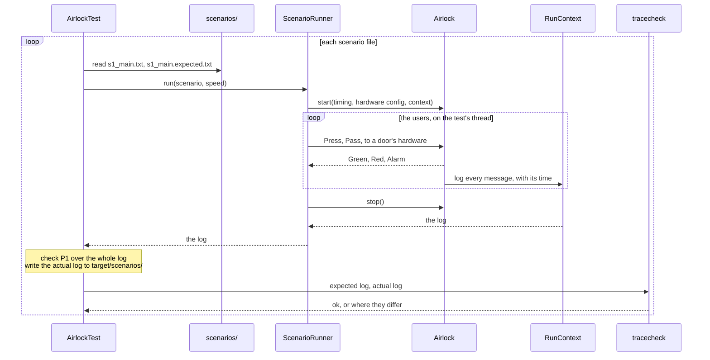

# Two-door airlock controller: test plan

How the specification in [SPEC.md](SPEC.md) is verified: what is tested, and
when it is enough (sections 1 and 2, independent of the language), and how
the tests are built, in Rust (`rust/`) and Java (`java/`) (section 3). Ids
(J1, A1, E1, P1, D1, S1, ...) refer to SPEC.md and to the scenarios below.
Each test is a scenario, run on the real threads: a text file saying what the
users do and what goes wrong, and an expected log, the messages the system
must log, written from the specification.

## 1. Criteria

The tests are adequate when:

1. **Coverage.** The scenarios exercise every user journey (J1 to J4), the
   alternative and exception flows (A1, E1), and every state machine
   transition (T1 to T12), as section 2 shows.
2. **Requirements verification.** Every property (P1 to P4) is challenged by
   at least one scenario. The actual logs match the expected logs, timing
   bounds included, and the expected logs are written from the specification,
   never from the program's output: when they differ, the specification
   decides whether the code or the specification is wrong. P1 is also checked
   over each whole log, since a gap (`...`) in an expected log may hide a
   violation.
3. **Design conformance.** The decision functions (`on_input` in Rust,
   `onInput` in Java) are reviewed against their state machines (SPEC.md,
   section 3.3): every transition, with its guard, outputs and next state;
   nothing more; and every other event ignored (the sneak paths). The expected
   logs also check the messages between the components against the specified
   scenarios and protocol. The review is repeated after every change to a
   state machine or its code.
4. **Concurrency.** S5 runs 10 times, to exercise competing requests: every
   run must match one of the outcomes allowed.

**Limitations.** Passing these tests is evidence that the tested scenarios
are right, not proof for every interleaving of the threads. Only a stuck door
is simulated as a fault; lost or duplicated messages, other sensor faults and
arbitrary delays are not. A message out of protocol in a part of the log that
an expected log skips (`...`) may go unseen, unless it also breaks P1.

## 2. Test scenarios

Each scenario has a scenario file and an expected log in `scenarios/`, in the
format of section 3.3 (where "walk" and "cross" are defined); times are as on
a real airlock. Only S1 has a sequence diagram (SPEC.md, section 3.2); the
others are described here, in enough detail to write their expected logs.
Each name gives the journeys and flows it runs, then the properties it
challenges.

| # | Scenario | What happens | Inputs | Expected log | New transitions |
|---|---|---|---|---|---|
| S1 | Main scenario (J1; P1, P2, P4) | A user goes in, through A and then B; once inside, the user presses B while A is still closing, so B waits for the token, which A hands over once closed. | user 1 at 0 through A, B; walk 1 s, cross 0.5 s | all of it, as in the sequence diagram of SPEC.md, section 3.2 | T1 to T4, T6, T9 to T12 |
| S2 | Door A stuck while closing (J1, E1; P1, P3) | As S1 until the user has gone through A and pressed B, which is queued; A never confirms it has closed, so on its timeout it raises the alarm and keeps the token: B never opens, and the user is shut in. | as S1; A's closing (its 2nd movement) never confirmed | the end: A starts closing, B is queued, A times out `MOVE_TIMEOUT` later and raises the alarm; nothing after | T8 |
| S3 | Door A stuck while opening (J1, E1; P3) | A is granted the token and starts opening, but never confirms it is fully open: on its timeout it raises the alarm and keeps the token. | user 1 at 0 through A, B; A's opening (its 1st movement) never confirmed | the end: A starts opening, times out `MOVE_TIMEOUT` later and raises the alarm; nothing after | T7 |
| S4 | The user is slower than `MAX_OPEN` (J1, A1; P3, P4) | The user takes 7 s to go through A, so A closes on its timer first, with no alarm; the user stays outside. | as S1, but walk 7 s | the end: A fully open, then its timeout `MAX_OPEN` later, and a normal closing | T5 |
| S5 | Two users at the same time, one each way (J1, J2, J4; P1, P2) | User 1, outside, and user 2, in the room, press A and B at the same instant, so the requests race to the interlocker. If A wins: A opens and user 1 goes in; B opens and the two swap places; A opens again for user 2. Three door cycles, one at a time, the token handed over each time. If B wins, the mirror image. | user 1 at 0 through A, B; user 2 at 0 through B, A; walk 1 s, cross 0.5 s; run 10 times | one of two alternatives, mirror images; how often each happened is reported | none |
| S6 | A user goes in and comes back (J3; P2) | The user goes in through A and back out through A, pressing A again after it has closed: two cycles of A, and B never opens. | user 1 at 0 through A, A; walk 1 s, cross 1.5 s | all of it: two cycles of A, each from `Button` to `Release` | none |

To test more, add a scenario file and its expected log: one test runs every
file in the folder.

Each transition of the state machines has an id in SPEC.md, section 3.3: T1
to T8 for the door, T9 to T12 for the interlocker. The last column of the
table above gives the transitions each scenario adds to those before it:
together, S1 to S4 take all twelve, and every state is reached (`Fault` only
by S2 and S3). S5 and S6 add no transition; they add journeys and
concurrency. The coverage is designed, not measured by the tests, but the
expected logs check it: each names the messages of the transitions its
scenario adds, so a scenario that missed one would fail.

## 3. Test implementation

### 3.1 Test architecture

The tests drive the system from outside, as its users would, and judge it
only by its log. One test runs every scenario file through the test driver,
checks P1 over the log, and has the provided tool,
[`tracecheck`](tracecheck/README.md), compare it with the expected log:



| Part | Where | Responsibility |
|---|---|---|
| The scenarios | `scenarios/`, shared by both versions | a scenario file and an expected log for each scenario (section 3.3) |
| The test | `rust/tests/airlock_test.rs`: `every_scenario_file`<br>`java/src/test/java/airlock/AirlockTest.java`: `everyScenarioFile` | runs every scenario file through the test driver; checks P1 over the whole log (`both_doors_open`, `bothDoorsOpen`), since an expected log with gaps cannot; writes the actual log to `target/scenarios/`, and runs `tracecheck` on it; reports which alternative each run of S5 matched |
| The test driver | `rust/tests/scenario_runner/mod.rs`<br>`java/src/test/java/airlock/ScenarioRunner.java` | reads a scenario file into a `Scenario` (users, times, fault); `run(scenario, speed)` starts the airlock with its times divided by `speed` (section 3.4), plays the users on the calling thread, who talk only to the doors' hardware (section 3.2), stops the airlock, and returns the log in the airlock's time |
| The checker | `tracecheck/tracecheck.py`, shared by both versions | compares an actual log with its expected log, in order and within the time bounds, and says where they differ; the same tool for any language (Python 3.8 or later, standard library only) |
| Run every test | in `rust/`: `cargo test` (and `cargo clippy --all-targets`)<br>in `java/`: `mvn test` (compiler warnings are errors) | |

The system is in `src/` (Rust) and `java/src/main/java/airlock/`; the test and
the test driver, in `tests/` and `java/src/test/java/airlock/`. They use the
system only through `Airlock.start`, `stop` and the messages; the system
never uses them (SPEC.md, section 3.4).

A test in any other language does the same: run the scenarios, write the
actual logs (section 3.3), and run `tracecheck` on each. It can also be run by
hand: `python tracecheck/tracecheck.py --dir scenarios rust/target/scenarios`.

### 3.2 The fake environment

The test driver plays the users, on the test's thread; they talk only to the
doors' hardware, a fake that is part of the system (SPEC.md, D3) and moves a
door in `TRAVEL`, unless the scenario makes it stuck.

A scenario describes users, not the system's inputs one by one: each user
arrives at a given time and has a route, the doors they want to go through, in
order. A user presses the button of the next door on their route. When a
door's light turns green, everyone waiting at it, on either side, goes
through together `walk` later. Once through a door, a user presses the next
door's button `cross` later. The users are known only to the scenario: the
system never identifies them, and the log holds only its own events.

A run ends when no user action is still planned and `RESPONSE_LIMIT` + 2 s
has passed since the last press: long enough for that press to be served or
to time out, and always finite, even when users never finish their routes
(S2, S4). The test driver then stops every thread and returns the whole log.

**Limitation: these users never press a button again.** A press while a door
is closing is ignored, so a user who presses then waits for ever (hence S6's
long `cross`); a user who reaches an open door too late (S4) stays put. Real
users would press again.

### 3.3 Scenario files and expected logs

A scenario file (`scenarios/<name>.txt`) has one item per line; text after
`#` is a comment. The parameters hold for the whole run, wherever they are
written. A door's movements are counted from the start of the run, openings
and closings alike: the 1st is its first opening, the 2nd its first closing.

```text
walk = 1000                # users go through 1000 ms after a light turns green (default 1000)
cross = 500                # a user presses the next door's button 500 ms after going through one (default 500)
travel = 1500              # a door takes 1500 ms to move (default TRAVEL, 1000)
stuck = a 2                # the fault: door A's 2nd movement, its first closing, is never confirmed (default none)
user 1 at 0 through a b    # user 1 arrives at 0 ms, and goes through A, then B
```

Its expected log (`scenarios/<name>.expected.txt`) has one line per arrow to
or from a controller, in order, as the log prints it (the arrows between the
users and the hardware are not logged). A line `...` stands for any number of
messages, and a line `or` separates alternatives; without a final `...`,
nothing may follow the last line, so the end of the log is checked too. A
label (`t1:`) names a
line, and a later line may bound its time from it: `after <ms> of t1` (at
least) and `within <ms> of t1` (at most, plus `SLACK`), with the required
time of SPEC.md, section 2.2, named in a comment. The full notation is in
[tracecheck/README.md](tracecheck/README.md).

The messages, and the form each takes in the log, are in SPEC.md, Table 4.
To write an expected log, follow the scenario through the state machines
(SPEC.md, section 3.3): each message a door receives (`In`) is followed by the
outputs of the transition it triggers, in the order the state machine lists
them. A door's `Request` is followed by the interlocker's
`LockOut(Granted(…))` if the token is free, and its `Release` by the next
door's `LockOut(Granted(…))` if one is waiting; the door's own received
`Granted` is left out, as Table 4 explains. S1's expected log, complete, is
the worked example. When only the end of a log matters, start it at the
first message that shows what the scenario is about, as S2 to S4 do.

```text
...                                               # only the end of the log is compared
In(A, Passed)
Out(A, Light(Red))
Out(A, Motor(Close))
t1: Out(A, StartTimer(2000))
In(B, Button)
Out(B, Request)
In(A, Timeout)              after 2000 of t1  within 2000 of t1    # P3: MOVE_TIMEOUT
Out(A, Alarm)
```

A scenario whose expected log has alternatives (S5) runs 10 times, the others
once; `REPEAT=n cargo test` or `REPEAT=n mvn test` runs each n times. The
scenarios run one after the other, so that they do not delay each other's
threads. For each, the test writes the actual log to
`target/scenarios/<name>.actual.txt`, in the format of the expected log with
each message's time as a comment. Never copy an actual log into an expected
log (criterion 2).

### 3.4 Testing on real threads

Everything runs on real threads and the real clock, `speed` times faster than
real time (10). The airlock does not know it (SPEC.md, D9): the run divides
every time by `speed` (the doors' times, given when the airlock starts, the
doors' travel and the users' times) and multiplies the times in the log back,
`StartTimer` durations included, so logs and expected logs are in the
airlock's time. `speed` must divide 1000.

The operating system decides the schedule, and threads are late by up to a
few tens of milliseconds, sometimes more. So:

- Scenarios keep independent events apart, by half a second or more, which
  makes a change of order unlikely, but not impossible. Where several orders
  remain possible, the expected log allows each of them, with `or` or with a
  gap: in S5, a user's press may reach a door just before the other door
  releases the token, or just after.
- A `within` bound allows `SLACK` more than the requirement, since threads
  are late. An `after` bound allows nothing less: a correct timer never fires
  early. That relies on the implementation logging `StartTimer` before it
  sets the deadline, as both versions do.
- The scenarios are the same every time, but their timing is not, so a
  failure may not repeat: run it again (`REPEAT`), and read its actual log.

| Name | Value | Meaning |
|---|---|---|
| `TRAVEL` | 1 000 ms | fake hardware: time a door takes to move, unless the scenario file says otherwise |
| `SLACK` | 500 ms | how late a bounded line may be beyond its bound (`tracecheck --slack`): 50 ms of real time at speed 10, well above the threads' lateness |
